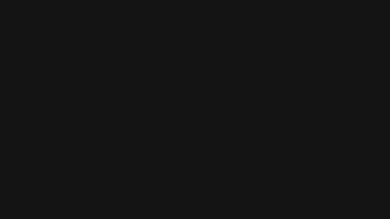

  

<h1 align="center">VESPER DIGITAL — EVIDENCE ARCHIVE</h1>

<b>The source documents behind every video.</b>

This is the public record room for Vesper Digital. Every claim made in a video is backed by a document, and every one of those documents is here, in full, exactly as it was obtained.

Nothing here is summarized for you. There is no commentary in these folders, no highlighting, no editing. You get the original government records, filings, contracts, disclosures and correspondence so you can read them yourself and come to your own conclusion. If you disagree with the reading given in a video, this is where you go to prove it.

Download anything. Share anything. Check the work.

**How to download:** open a folder, click a file, then click the download button on the file page. To take a whole case at once, use the green **Code** button at the top of this repo and choose **Download ZIP**.

---

## CASES

<table>
<tr>
<td width="300"></td>
<td>
<h3>Case Title Goes Here</h3>
<b>January 1, 2026</b>  
<a href="./01-case-name/Files"><b>▸ FILES</b></a> &nbsp;&nbsp;&nbsp; <a href="./01-case-name/Images"><b>▸ IMAGES</b></a>
</td>
</tr>
</table>

---

<!-- ===== COPY FROM HERE DOWN TO ADD A NEW CASE =====
Change 4 things: the thumbnail name, the title, the date, and the folder name in both links.

<table>
<tr>
<td width="300"></td>
<td>
<h3>Case Title Goes Here</h3>
<b>Month 00, 2026</b>  
<a href="./02-case-name/Files"><b>▸ FILES</b></a> &nbsp;&nbsp;&nbsp; <a href="./02-case-name/Images"><b>▸ IMAGES</b></a>
</td>
</tr>
</table>

---
===== COPY TO HERE ===== -->

## ADDING A CASE

1. Copy the `_TEMPLATE-CASE` folder on your computer, rename it `02-case-name`.
2. Put the documents in `Files`, the screenshots in `Images`.
3. Drag the folder into this repo with **Add file ▸ Upload files**.
4. Put the YouTube thumbnail in `assets` named `case-02.jpg`.
5. Edit this README, paste the block above, change the four things.

## CONTACT

Corrections and document tips: makhloel@gmail.com
